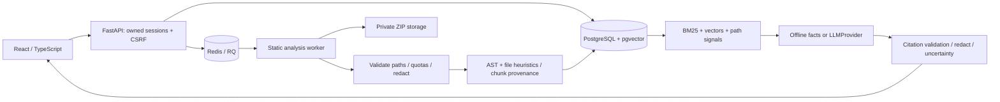

# Architecture

ProjectTrace is a modular monolith with a separate analysis worker. Imported repositories are data, never workloads.

## Boundaries

- `core`: centrally validated settings, SQLAlchemy unit of work.
- `parsers`: ZIP streaming, file allowlist, Python AST routes and symbols, technology heuristics.
- `security`: Argon2, opaque session tokens, HMAC token hashes, CSRF, rate limits, redaction.
- `services`: transactional analysis, claims, GitHub snapshot retrieval, audit, intelligence.
- `retrieval`: `EmbeddingProvider` and `VectorStore` interfaces; FAISS and pgvector implementations.
- `ai`: OpenAI Responses structured output behind `LLMProvider`; no tools/code execution.
- `workers`: RQ for deployment; separate durable single-process SQL queue for local demonstrations.

## Data and provenance

Normalized tables cover users, sessions, projects, snapshots, files, chunks, artifacts, claims, claim-evidence links, findings, jobs, viva sessions/questions, generated documents and snapshot-scoped answer caches. UUIDs identify rows. Foreign keys cascade derived data when a project is deleted. Indexes cover ownership, snapshots, job states and claim states. A partial unique index protects against concurrent active analysis of one project.

A GitHub import resolves the default branch to a commit SHA and downloads from the fixed codeload host. ZIP imports use SHA-256 of the uploaded archive, clearly labeled as an archive snapshot rather than a Git commit. Chunks preserve project/snapshot/file IDs, path and line range. Historical snapshots are immutable once completed; prior verified claims missing from a new snapshot become stale in the new ledger.

Analysis writes derived evidence and updates the latest-snapshot pointer in one transaction. On failure, rollback preserves the last successful snapshot and a separate job transaction records a safe failure. Upload retries create a new snapshot. Recovery marks jobs with expired worker activity as failed; users can retry. RQ jobs have a bounded timeout. The local worker is a single-process demo adapter and is not a production queue.

## Retrieval and generation

Lexical BM25, vector similarity, filename signals and code/document weighting contribute to retrieval. FAISS flat inner-product search is the local adapter; PostgreSQL uses vector cosine distance. `hashing-v1` is a deterministic lexical vector baseline, **not a semantic embedding model**. Optional Sentence Transformers with a 384-dimensional model supports semantic embeddings. Models are chosen by administrators and `trust_remote_code` is disabled.

Q&A caches are snapshot scoped and accessible only through owner-checked project routes. Provider identity/model is part of the cache key. External Q&A uses six trimmed, re-redacted excerpts, a bounded output budget, timeouts and two SDK retries. Citation IDs must belong to the retrieved context. AI answers remain inferred: citation validation does not prove semantic entailment. Offline mode answers narrow technology/configuration questions and returns uncertainty for arbitrary workflows. Documents and viva use conservative evidence templates, with unsupported purpose/contribution fields labeled for author input.

## Current practical limits

Heuristics do not prove functionality, security, test success or deployment. Retrieval currently loads the bounded chunk corpus in memory and builds a flat local index per uncached query; it needs profiling and a persisted ANN index before large deployments. Documents/PPTX/PDF/DOCX import, semantic claim entailment and private-repository OAuth are extension points, not implemented features. Worker retention maintenance runs separately in container mode and inside the local worker loop.

Public GitHub metadata uses the REST API first. When its public quota is exhausted, a bounded `git ls-remote --symref` lookup resolves HEAD with credential helpers, local/global Git configuration and non-HTTPS protocols disabled. It uses a fresh empty temporary directory, does no clone/checkout and executes no repository hooks or files. [Git reference lookup documentation](https://git-scm.com/docs/git-ls-remote).
